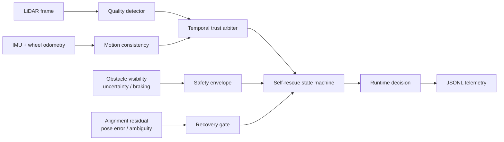

# SensorGuard-NAV

面向传感器污染与观测残缺场景的定位自救运行时中间件。首版聚焦 **LiDAR 污染 +
IMU/轮速冗余**，把故障注入、异常检测、可信度隔离、安全降级、恢复门控和诊断回放串成
一个可运行、可测试的闭环。

> 当前仓库提供与中间件无关的 Python 参考实现和确定性合成场景，不包含 ROS 2 二进制节点、
> 真实机器人数据或实机性能结论。

## 为什么做这个项目

镜片脏污、泥浆遮挡和数据冻结不仅会破坏定位，也可能同时削弱动态避障。仅切换到
Dead Reckoning 后继续正常速度行驶并不安全。本项目把“定位是否可信”和“当前还能以多快的
速度移动”分开计算：前者决定数据源隔离和恢复路径，后者由视场、不确定性、制动距离和故障
持续时间共同约束。

## 系统闭环



核心状态：

```text
HEALTHY → SUSPECT → DEGRADED_ODOMETRY → SAFE_STOP
                            ↓                ↓
                 RECOVERING_LOCAL / RECOVERING_GLOBAL
                            ↓                ↓
                         HEALTHY       MANUAL_REQUIRED
```

所有决策都携带 `reason` 和 `evidence`。状态机拒绝未定义跃迁，恢复阶段要求连续健康帧和
几何一致性，避免刚清洁的传感器立即重新接管。

## 已实现

- LiDAR 点数、有限值、角覆盖、距离分布和强度质量检测；
- scan matching 与 IMU/轮速增量一致性检测，含角度回绕；
- EMA、滑动窗口、滞回阈值与连续帧确认的可信度仲裁；
- 七态定位自救状态机和超时保护；
- 基于定位不确定性、障碍视场、制动距离和故障时长的安全速度包络；
- 局部对齐、全局重定位和人工接管恢复门控；
- dropout、扇区遮挡、距离偏置、噪声、强度衰减、NaN、冻结和延迟注入；
- 合成污染场景、JSONL 时间线及摘要报告；
- 不依赖 ROS 的适配协议，便于接入 AMCL、SLAM Toolbox 或 LIO。

## 快速开始

```bash
python3.11 -m venv .venv
source .venv/bin/activate
python -m pip install -e ".[dev]"

sensor-guard-nav demo \
  --config configs/lidar_mud.json \
  --output artifacts/lidar-mud

pytest
ruff check .
ruff format --check .
```

演示依次生成正常、渐进污染、严重污染和清洁恢复阶段，并输出：

- `timeline.jsonl`：逐帧模式、可信度、安全速度、转换原因和证据；
- `summary.json`：模式分布、故障统计、停车帧和最终状态。

这些数据只验证软件行为，不代表真实检测率或机器人安全认证。

## 评价指标

- 污染检测延迟和假降级率；
- 故障期间最大定位漂移；
- 不安全运动持续时间和停车距离；
- 重定位耗时与恢复成功率；
- 错误传感器重新接管次数；
- 每次状态转换是否可由日志完整解释。

详见：

- [架构与状态机](docs/architecture.md)
- [检测、安全降级与恢复](docs/fault-handling.md)
- [ROS 2 集成边界](docs/ros2-integration.md)
- [实验与评价口径](docs/evaluation.md)

## 工程边界

- 当前仅实现 LiDAR 主定位源，IMU和轮速用于运动一致性与短时降级证据；
- 合成点云不能替代雨雾、泥浆、反光和真实运动畸变数据；
- 未提供 AMCL、SLAM Toolbox、FAST-LIO 等系统的二进制适配节点；
- 默认阈值是演示配置，部署前必须通过传感器标定、系统辨识和实车回放重新确定；
- `SAFE_STOP` 只产生决策，最终制动必须由机器人安全控制器执行。

## 路线

- [x] 可审计的检测—仲裁—降级—恢复参考闭环
- [x] 确定性故障注入和回放报告
- [ ] ROS 2 lifecycle node 与诊断消息
- [ ] 公开 rosbag 基准和阈值标定工具
- [ ] Camera / mmWave 插件及跨传感器故障隔离
- [ ] 硬件清洁器“触发—验证—重试”接口
- [ ] shadow mode、封闭场地和实机分级验证

## License

MIT。第三方依赖和未来接入的数据、资产、ROS软件包保留各自许可证，详见
[THIRD_PARTY.md](THIRD_PARTY.md)。
